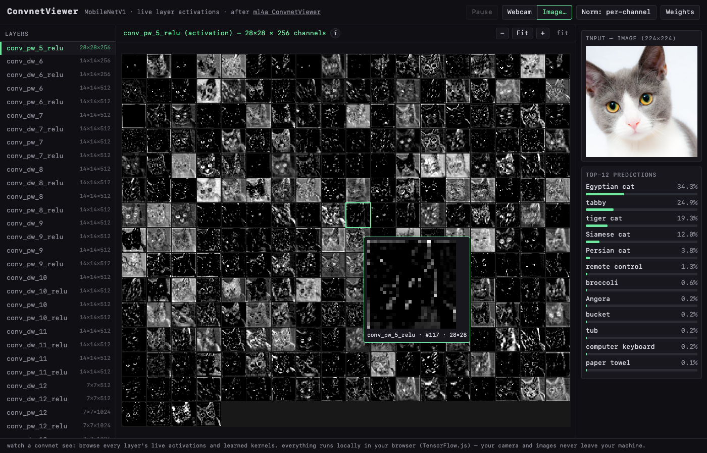

# ConvnetViewer — 2026

A modern rebuild of [ml4a-ofx ConvnetViewer](https://github.com/ml4a/ml4a-ofx/tree/master/apps/ConvnetViewer)
(Gene Kogan's *Machine Learning for Artists* toolkit): point your webcam at the
world and live-browse the activations of every layer of an ImageNet convnet.

The original was an openFrameworks + ofxCcv (libccv) app whose toolchain no
longer builds on modern systems. This version is a single-page web app —
no install, no build step — using [TensorFlow.js](https://www.tensorflow.org/js)
and a pretrained **MobileNetV1** running entirely in your browser (WebGL).
Nothing is uploaded anywhere; inference happens on your machine.



## Run it

Webcam access requires a secure context, so serve the folder instead of
opening `index.html` directly:

```sh
cd updatecovnetviewer
python3 -m http.server 8000    # or: npx serve
```

Then open <http://localhost:8000> and grant camera access.
No webcam / no permission? Use **Load image…** or drag-and-drop any image.

The first load fetches ~17 MB of model weights from the TensorFlow.js model
CDN; after that it is cached by the browser.

## Controls

| Control | Action |
|---|---|
| click a layer / `↑` `↓` | browse through the network's layers |
| `I` / ⓘ button | explain the selected layer (what it does, shapes, params, receptive field) |
| pinch / `Ctrl`+scroll / `+` `−` | zoom the activation grid (toward the cursor) |
| `0` / Fit button | fit the grid to the window |
| drag the grid | pan around when zoomed in |
| click a tile | magnifying-glass view of that channel, pinned by the tile (re-click or `Esc` to close) |
| `Space` / Pause button | freeze the current webcam frame (disabled for still images) |
| `N` / Norm button | toggle per-channel vs whole-layer normalization |
| `W` / Weights button | show the selected layer's learned kernels instead of activations |
| Webcam / Image… | pick the input source — the active one is highlighted (drag-drop also loads an image) |

## What you're looking at

Each gray tile is one **channel** (feature map) of the selected layer's
activations for the current frame — bright pixels are locations where that
filter fired. Early layers (`conv1_relu`) respond to edges and colors at high
resolution; deeper layers (`conv_pw_13_relu`) respond to object-level features
at coarse resolution. The last few entries (`reshape_1`, `conv_preds`,
`act_softmax`) show the 1×1 "embedding" and class-score stages as pixel grids,
and the top-12 ImageNet predictions update live on the right.

**Normalization:** *per-channel* stretches each tile's own min→max (every tile
shows its structure); *layer* uses one scale for the whole layer (honest about
which channels fire strongly, weak ones go dark).

**Weights view (`W`):** instead of what the layer *computed*, show what it
*learned* — the convolution kernels themselves, frozen since training.
Mid-gray is zero; brighter is positive, darker is negative weight.
`conv1` renders its 3×3 kernels in color (the three input channels are RGB);
depthwise layers show one 3×3 kernel per channel; pointwise (1×1) layers are
drawn as their full in×out weight matrix — the layer's wiring diagram
(zoom in: each row is an input channel, each column an output channel).
ReLU layers have no weights, so the nearest conv above is shown.

## Files

- `index.html` / `style.css` / `main.js` — the whole app (vanilla JS, tfjs from CDN)
- `imagenet_labels.js` — the 1000 ImageNet class names, vendored
- `assets/test-cat.jpg` — sample image (from the tfjs-examples repo)

Console/test hooks live on `window.__viewer` (`selectLayer`, `loadImageFromUrl`,
`state`, …) if you want to script it.
